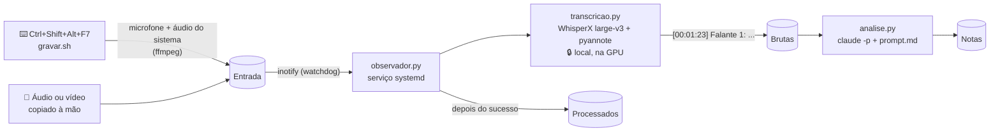

# 🎙️ Transcritor Automático de Reuniões

> Aperte um atalho para gravar a reunião. Ao parar, receba a transcrição com os falantes
> identificados e uma nota organizada em Markdown — com a transcrição feita **localmente, na sua GPU**.


Ferramenta pessoal para Linux que grava reuniões (microfone **e** áudio do sistema), transcreve em
português com [WhisperX](https://github.com/m-bain/whisperX) — com marcação de tempo por palavra e
separação de falantes — e usa o [Claude Code](https://claude.com/claude-code) em modo não interativo
(`claude -p`) para gerar uma nota com resumo, decisões, tarefas, pontos técnicos e dúvidas em aberto.
Tudo roda em segundo plano, como um serviço que sobe no login.

## Sumário

- [Como funciona](#como-funciona)
- [Destaques](#destaques)
- [Privacidade](#privacidade)
- [Requisitos](#requisitos)
- [Instalação](#instalação)
- [Uso](#uso)
- [Configuração](#configuração)
- [Estrutura do projeto](#estrutura-do-projeto)
- [Decisões técnicas](#decisões-técnicas)
- [Desempenho](#desempenho)
- [Solução de problemas](#solução-de-problemas)
- [Limitações](#limitações)
- [Roadmap](#roadmap)
- [Desinstalação](#desinstalação)
- [Licença e créditos](#licença-e-créditos)

## Como funciona



1. **Gravação** — o atalho `Ctrl+Shift+Alt+F7` inicia a gravação do microfone padrão misturado ao
   áudio que está tocando no computador; o mesmo atalho para. O MP3 vai para `~/Transcricoes/Entrada`.
2. **Detecção** — o serviço percebe o arquivo novo por eventos do sistema de arquivos (inotify), sem
   varrer a pasta, e espera a cópia terminar.
3. **Transcrição local** — o WhisperX transcreve com o modelo `large-v3` (float16, na GPU), alinha cada
   palavra ao instante exato do áudio e o pyannote identifica quem falou quando. O resultado vai para
   `Brutas/` no formato `[00:01:23] Falante 1: ...`.
4. **Nota** — o texto é enviado ao `claude -p` junto com as instruções de [`prompt.md`](prompt.md). A
   nota é salva em `Notas/AAAA-MM-DD_HHMM_nome.md`, e o áudio original é movido para `Processados/`.

## Destaques

- **Um atalho, zero digitação** — notificações na tela ao iniciar, ao salvar e em caso de erro.
- **Áudio do sistema que acompanha você** — grava sempre a saída de áudio *atual* (HDMI, fone
  Bluetooth, USB…), sem nomes de dispositivo fixos.
- **Transcrição em português de qualidade** — Whisper `large-v3`, alinhamento por palavra
  (wav2vec2 em português) e separação de falantes (pyannote).
- **Notas úteis** — cinco seções fixas; o Claude corrige termos técnicos e nomes mal transcritos,
  sem inventar o que não está na conversa.
- **Feito para rodar sozinho** — serviço systemd do usuário que sobe no login, retoma o que ficou
  pendente e reinicia em caso de falha.
- **Robusto** — um arquivo por vez, sem reprocessar; se só a nota falhar, a transcrição é
  reaproveitada na próxima tentativa; gravações interrompidas são recuperadas; nunca dois observadores
  ao mesmo tempo.

## Privacidade

| Etapa | Onde acontece |
|---|---|
| Gravação, transcrição, alinhamento e separação de falantes | **No seu computador** (GPU). O áudio nunca sai da máquina. |
| Geração da nota | O **texto** da transcrição é enviado ao Claude pelo `claude -p`, usando o seu plano. |

Depois da instalação, a transcrição roda **sem acesso à rede**: o `config.py` liga o modo offline do
Hugging Face e desliga duas telemetrias que vêm **ativadas por padrão** nas bibliotecas — a do
pyannote 4 e a do ONNX Runtime (usado pelo faster-whisper). Isso foi verificado com `strace`: zero
conexões externas durante a transcrição. Gravações, transcrições e notas nunca são versionadas
(veja o [`.gitignore`](.gitignore)).

## Requisitos

| | Mínimo / testado |
|---|---|
| **Sistema** | Linux Mint 22 ou Ubuntu 24.04, com PipeWire ou PulseAudio |
| **GPU** | NVIDIA com 8 GB de VRAM ou mais (testado: RTX 3060 12 GB), driver com CUDA ≥ 12.8 em `nvidia-smi` |
| **Disco** | ~15 GB (ambiente Python ~7,6 GB + modelos ~5,3 GB) |
| **Python** | 3.10 a 3.13 (testado: 3.12) |
| **Contas** | [Hugging Face](https://huggingface.co) (gratuita) e Claude Code com login |
| **Desktop** | Cinnamon para o atalho automático (em outros desktops, o atalho é criado à mão) |

Não é preciso instalar o CUDA Toolkit: o PyTorch traz o próprio runtime CUDA.

## Instalação

### Antes de começar: Hugging Face

O modelo de separação de falantes exige aceitar os termos de uso (gratuito):

1. Crie um token do tipo **Read** em <https://huggingface.co/settings/tokens>.
2. Logado na mesma conta, aceite os termos em
   <https://huggingface.co/pyannote/speaker-diarization-community-1>.

### Instalação rápida

```bash
git clone https://github.com/renato-mateus-almeida/ia-transcription-tools.git
cd ia-transcription-tools
./install.sh
```

O instalador pode ser executado quantas vezes quiser — ele só faz o que ainda falta:

1. confere a GPU, o Python e instala via `apt` o que faltar (`ffmpeg`, `git`, `python3-venv`,
   `pulseaudio-utils`, `libnotify-bin`) — pede a sua senha só se precisar;
2. cria o ambiente virtual e instala as dependências (a primeira vez baixa alguns GB);
3. cria o `.env` e pede o token do Hugging Face (digitado sem aparecer na tela);
4. oferece instalar o Claude Code, se ele não existir;
5. baixa os modelos uma única vez (~5 GB);
6. cria as pastas em `~/Transcricoes`;
7. instala e ativa o serviço `transcritor` (sobe a cada login);
8. cria o atalho `Ctrl+Shift+Alt+F7` no Cinnamon, sem mexer nos seus atalhos existentes.

| Opção | Efeito |
|---|---|
| `--sim` | Responde "sim" a todas as perguntas (não pede o token) |
| `--sem-modelos` | Não baixa os modelos agora |
| `--sem-servico` | Não instala o serviço systemd |
| `--sem-atalho` | Não cria o atalho de teclado |

> **Primeiro uso do Claude Code:** se ainda não fez login, rode `claude` uma vez no terminal e siga as
> instruções. O instalador avisa no final se isso estiver pendente.

<details>
<summary><b>Instalação manual, passo a passo</b></summary>

```bash
# 1. Pacotes do sistema
sudo apt install ffmpeg git python3-venv pulseaudio-utils libnotify-bin

# 2. Ambiente Python
python3 -m venv venv
venv/bin/pip install -r requirements.txt

# 3. Credenciais (edite o .env e preencha HF_TOKEN=)
cp .env.example .env && chmod 600 .env

# 4. Claude Code (e login, na primeira vez)
curl -fsSL https://claude.ai/install.sh | bash
claude

# 5. Modelos e pastas
venv/bin/python baixar_modelos.py
venv/bin/python config.py
```

**6. Serviço** — crie `~/.config/systemd/user/transcritor.service` (troque `/caminho/do/projeto`):

```ini
[Unit]
Description=Transcritor automático de reuniões
StartLimitIntervalSec=300
StartLimitBurst=5

[Service]
WorkingDirectory=/caminho/do/projeto
ExecStart=/caminho/do/projeto/venv/bin/python /caminho/do/projeto/observador.py
Environment=PYTHONUNBUFFERED=1
Restart=on-failure
RestartSec=10
Nice=5

[Install]
WantedBy=default.target
```

```bash
systemctl --user daemon-reload
systemctl --user enable --now transcritor
```

**7. Atalho** — em *Configurações → Teclado → Atalhos → Atalhos personalizados*, adicione um atalho
com o comando `/caminho/do/projeto/gravar.sh` e a tecla `Ctrl+Shift+Alt+F7`.

</details>

## Uso

### Gravar uma reunião

1. Aperte **`Ctrl+Shift+Alt+F7`** — aparece a notificação **"🔴 Gravando..."**.
2. Faça a reunião normalmente (chamada, vídeo, conversa presencial…).
3. Aperte **`Ctrl+Shift+Alt+F7`** de novo — **"✅ Gravação salva (mm:ss)"**.
4. Em alguns minutos a nota aparece em `~/Transcricoes/Notas/`.

Use fone de ouvido em chamadas: com caixa de som, o microfone também capta o áudio do computador e a
outra pessoa entra duas vezes na gravação. Por segurança, uma gravação esquecida é encerrada sozinha
após 4 horas.

### Processar um arquivo que você já tem

Copie qualquer áudio ou vídeo para `~/Transcricoes/Entrada/` — o serviço processa sozinho.
Formatos aceitos: `.mp3 .wav .m4a .ogg .flac .opus .aac .wma .mp4 .mkv .webm .mov .avi`.

### Onde ficam os resultados

| Pasta (`~/Transcricoes/`) | Conteúdo |
|---|---|
| `Entrada/` | Arquivos aguardando processamento |
| `Brutas/` | Transcrições brutas com falantes (`.txt`) |
| `Notas/` | Notas finais em Markdown |
| `Processados/` | Áudios e vídeos originais já tratados |
| `logs/` | `transcritor.log` (processamento) e `gravacao.log` (gravações) |

### Exemplo de nota

*Exemplo fictício, para ilustrar o formato.*

```markdown
# Reunião 12/11/2026 14:30 — reuniao_2026-11-12_143012

## Resumo executivo
Alinhamento semanal do time de backend sobre a migração do serviço de pagamentos para o
Kubernetes. A migração foi adiada uma semana para concluir os testes de carga.

## Decisões tomadas
- Adiar a migração para o dia 19/11.
- Manter o PostgreSQL 15 até o fim do trimestre.

## Tarefas
- [ ] Rodar o teste de carga no ambiente de homologação — Ana (Falante 2) (até 15/11)
- [ ] Atualizar o runbook de rollback — responsável não identificado

## Pontos técnicos
- O pod de pagamentos estoura a memória com mais de 500 requisições por segundo.
- Proposta de usar HPA com limite de 6 réplicas.

## Dúvidas em aberto
- O time de infraestrutura libera a janela de manutenção do dia 19?
```

### Comandos do serviço

| Ação | Comando |
|---|---|
| Ver o estado | `systemctl --user status transcritor` |
| Acompanhar os logs ao vivo | `journalctl --user -u transcritor -f` |
| Reiniciar (ex.: depois de atualizar o código) | `systemctl --user restart transcritor` |
| Parar / iniciar | `systemctl --user stop transcritor` / `systemctl --user start transcritor` |
| Não iniciar mais no login | `systemctl --user disable transcritor` |

### Execução manual (sem o serviço)

Útil para testar. Pare o serviço antes de rodar o observador à mão (o programa recusa uma segunda
instância):

```bash
venv/bin/python transcricao.py ~/reuniao.mp3        # só transcreve → Brutas/reuniao.txt
venv/bin/python analise.py ~/Transcricoes/Brutas/reuniao.txt   # só gera a nota
venv/bin/python observador.py                       # observador em primeiro plano (Ctrl+C para sair)
./gravar.sh                                         # liga/desliga a gravação, como o atalho
```

## Configuração

**`.env`** (criado a partir do [`.env.example`](.env.example); nunca vai para o Git):

| Variável | Padrão | Descrição |
|---|---|---|
| `HF_TOKEN` | — | Token "Read" do Hugging Face (obrigatório para a separação de falantes) |
| `TRANSCRICOES_DIR` | `~/Transcricoes` | Pasta base das cinco pastas de trabalho |
| `HF_HUB_OFFLINE` | `1` | `0` libera a rede para baixar modelos (o `baixar_modelos.py` já faz isso) |
| `CLAUDE_BIN` | `~/.local/bin/claude` | Caminho do Claude Code |
| `CLAUDE_TIMEOUT` | `900` | Tempo máximo (s) para gerar uma nota |

**[`config.py`](config.py)** — modelo (`large-v3`), `compute_type` (`float16`), idioma (`pt`),
`BATCH_SIZE` (reduza para 8 se faltar memória na GPU) e extensões aceitas.

**[`prompt.md`](prompt.md)** — as instruções que o Claude segue para escrever a nota. Edite para mudar
as seções, o tom ou o nível de detalhe.

**[`gravar.sh`](gravar.sh)** — `GRAVACAO_LIMITE` (segundos, padrão 4 h) e, para testes,
`GRAVACAO_MICROFONE` / `GRAVACAO_SISTEMA`.

## Estrutura do projeto

```text
.
├── gravar.sh           # liga/desliga a gravação (chamado pelo atalho)
├── observador.py       # serviço: observa Entrada, processa um arquivo por vez
├── transcricao.py      # WhisperX: transcrição, alinhamento e separação de falantes
├── analise.py          # gera a nota com claude -p
├── prompt.md           # instruções da nota para o Claude
├── config.py           # caminhos, modelo, logs e modo offline
├── baixar_modelos.py   # baixa/confere os modelos (usado na instalação)
├── install.sh          # instalador
├── requirements.txt    # dependências com versões fixadas
├── .env.example        # modelo do arquivo de credenciais
├── CLAUDE.md           # instruções para sessões do Claude Code que desenvolvem o projeto
└── docs/
    ├── PRD.md          # requisitos e tarefas do projeto (versão de trabalho)
    └── PRD.pdf         # PRD original
```

## Decisões técnicas

- **Gravação à prova de corrida** — o ffmpeg grava em blocos e pode passar 10 s sem o arquivo
  crescer. Por isso a gravação usa um nome oculto (`Entrada/.reuniao_….mp3`, ignorado pelo observador)
  e só é renomeada, de forma atômica, quando termina. Um processo "guardião" finaliza a gravação
  também quando bate o limite de duração ou quando o ffmpeg cai.
- **Dispositivos dinâmicos** — `-f pulse -i default` e `@DEFAULT_MONITOR@` seguem o microfone e a
  saída de áudio atuais; nada de nomes fixos de placa de som.
- **Detecção por eventos** — `watchdog` (inotify) em vez de varredura periódica, com fila de um único
  processador e espera até o tamanho do arquivo parar de mudar.
- **GPU sob controle** — cada modelo é carregado, usado e liberado antes do próximo, mesmo em caso de
  erro (`try/finally`).
- **`claude -p` isolado** — sem nenhuma ferramenta (`--tools ""`), sem conectores MCP, sem gravar a
  sessão em disco, executado fora do repositório (para não carregar o `CLAUDE.md` do projeto), com a
  transcrição via stdin (argumentos no Linux são limitados a 128 KB) e timeout. O conteúdo da
  transcrição é tratado só como dado, nunca como instrução.
- **Falhas sem perda** — a nota só é gravada inteira (arquivo temporário + rename); o áudio só sai de
  `Entrada/` depois do sucesso; uma transcrição pronta é reaproveitada se só a nota falhar.
- **Instância única** — trava com `flock`, liberada automaticamente se o processo morrer.
- **Log limpo** — formato único, com cor só no terminal; bibliotecas mostram apenas avisos e erros.

## Desempenho

Medido numa RTX 3060 (12 GB), com os modelos em cache:

| Medida | Valor |
|---|---|
| Áudio de 40 s, do arquivo na `Entrada` até a nota pronta | ~35 s (transcrição ~20 s, nota ~8 s) |
| VRAM durante a transcrição (`large-v3`, float16) | ~4,8 GB |
| Download inicial (dependências + modelos) | alguns GB de pacotes + ~5 GB de modelos |

Boa parte do tempo de um arquivo curto é o carregamento dos modelos; em reuniões longas o tempo
cresce com a duração do áudio.

## Solução de problemas

<details>
<summary><b>O atalho não faz nada</b></summary>

Confira se o atalho aparece em *Configurações → Teclado → Atalhos → Atalhos personalizados*. Rode
`./gravar.sh` no terminal para ver se a gravação inicia, e consulte `~/Transcricoes/logs/gravacao.log`.
</details>

<details>
<summary><b>A gravação não tem o áudio do sistema</b></summary>

A gravação capta a saída de áudio que é a padrão no momento em que ela começa. Confira em
*Configurações → Som* qual saída está ativa. Se você trocar de saída durante a gravação (por exemplo,
conectar um fone Bluetooth), o áudio do sistema pode deixar de ser captado: pare e inicie de novo.
</details>

<details>
<summary><b>"Já existe um observador rodando"</b></summary>

O serviço já está ativo. Para rodar o observador à mão, pare antes: `systemctl --user stop transcritor`.
</details>

<details>
<summary><b>Erro de modelo não encontrado / LocalEntryNotFoundError</b></summary>

A transcrição roda offline e não baixa modelos sozinha. Se o cache (`~/.cache/huggingface`) foi
apagado, baixe de novo com `venv/bin/python baixar_modelos.py`.
</details>

<details>
<summary><b>Erro 401/403 ou "gated repo" na separação de falantes</b></summary>

Aceite os termos em <https://huggingface.co/pyannote/speaker-diarization-community-1>, logado na mesma
conta do token, e confira o `HF_TOKEN` no `.env`.
</details>

<details>
<summary><b>CUDA indisponível</b></summary>

Verifique o driver com `nvidia-smi`. Depois:
`venv/bin/python -c "import torch; print(torch.cuda.is_available())"` deve imprimir `True`.
</details>

<details>
<summary><b>A transcrição saiu, mas a nota não</b></summary>

Veja o motivo em `journalctl --user -u transcritor -n 50`. Causas comuns: Claude Code sem login (rode
`claude` uma vez) ou limite do plano atingido. O áudio fica em `Entrada/` e a transcrição em `Brutas/`;
ao reiniciar o serviço (`systemctl --user restart transcritor`), a nota é gerada reaproveitando a
transcrição.
</details>

## Limitações

- A separação de falantes erra com falas sobrepostas ou vozes parecidas, e os falantes não têm nome
  ("Falante 1", "Falante 2"…), a menos que alguém seja chamado pelo nome na conversa.
- Termos técnicos podem sair errados na transcrição; o Claude corrige quando o contexto deixa claro.
- Cada nota consome um pouco do limite do seu plano do Claude.
- Somente Linux com GPU NVIDIA, por enquanto.

## Roadmap

- [ ] Renomear falantes automaticamente pelo contexto da conversa
- [ ] Enviar notas para Notion, Obsidian ou Google Drive
- [ ] Suporte a Windows e macOS, separando o núcleo (Python) dos adaptadores de cada sistema
  (gravação, atalho, serviço e instalação)

## Desinstalação

```bash
systemctl --user disable --now transcritor
rm ~/.config/systemd/user/transcritor.service && systemctl --user daemon-reload
# Atalho: remova em Configurações → Teclado → Atalhos → Atalhos personalizados
rm -rf venv                              # ambiente Python (~7,6 GB)
rm -rf ~/.cache/huggingface/hub/models--Systran--faster-whisper-large-v3 \
       ~/.cache/huggingface/hub/models--jonatasgrosman--wav2vec2-large-xlsr-53-portuguese \
       ~/.cache/huggingface/hub/models--pyannote--speaker-diarization-community-1   # modelos (~5,3 GB)
```

A pasta `~/Transcricoes`, com as suas gravações e notas, não é apagada.

## Licença e créditos

Distribuído sob a licença MIT — veja [`LICENSE`](LICENSE).

Construído sobre projetos abertos excelentes:
[WhisperX](https://github.com/m-bain/whisperX),
[faster-whisper](https://github.com/SYSTRAN/faster-whisper) /
[OpenAI Whisper](https://github.com/openai/whisper),
[pyannote.audio](https://github.com/pyannote/pyannote-audio),
[wav2vec2 em português](https://huggingface.co/jonatasgrosman/wav2vec2-large-xlsr-53-portuguese)
e [watchdog](https://github.com/gorakhargosh/watchdog). As notas são geradas com o
[Claude Code](https://claude.com/claude-code), da Anthropic.

O projeto foi desenvolvido tarefa a tarefa a partir do [PRD](docs/PRD.md), com o Claude Code como par
de programação.
